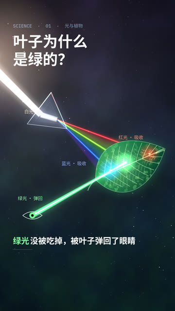
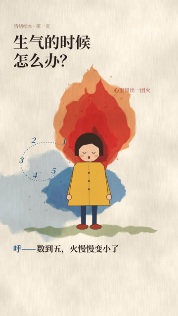

# kids-knowledge-video

把一个儿童知识点做成约 30 秒、1080×1920 竖屏知识短视频的 **Agent Skill**。

这是一套已经跑通的个人流程，核心不是「会画动画」，而是：

1. **对内容的理解**：把知识点写成大班到六年级听得懂的旁白和分镜（一个核心观念、问句开场、具体比喻、三步结构、闪卡复习）。
2. **配乐与音效**：用 AI 生成真乐器感的配乐，再用真实音效对齐画面事件，和旁白一起混音（人声下压配乐约 10 dB，成片 -14 LUFS）。

画面采用确定性 HTML/Canvas 动画（`window.render(t)`），Playwright 无头截帧，ffmpeg 编码为 H.264 yuv420p。已确认可直接使用的风格：

- 科学：**光之剧场**（`templates/cinematic-light/`）
- 情绪与社交：**水彩绘本**（`templates/watercolor-book/`）

预览（缩小图）：




给 Agent 看的步骤写在 [SKILL.md](SKILL.md)。内容方法和配乐细节在 `references/`。

## 在 Claude Code / Codex / DeepSeek Harness（dsh）里调用

把本仓库拷贝或软链接到对应的 skills 目录，目录名保持 `kids-knowledge-video`（与 `SKILL.md` 里的 `name` 一致）：

```bash
# Claude Code
ln -s /path/to/kids-knowledge-video ~/.claude/skills/kids-knowledge-video

# Codex
ln -s /path/to/kids-knowledge-video ~/.codex/skills/kids-knowledge-video
# 若你的 Codex 技能目录不同，改成实际路径

# DeepSeek Harness (dsh)
ln -s /path/to/kids-knowledge-video ~/.dsh/skills/kids-knowledge-video

# 通用 / 其他支持 Agent Skills 的工具
ln -s /path/to/kids-knowledge-video ~/.agents/skills/kids-knowledge-video
```

然后在对话里直接说：用 kids-knowledge-video 做一个关于「……」的 30 秒竖屏知识视频。Agent 应先读 `SKILL.md`，再按里面的步骤做。

## 环境

需要：Python 3.10+、ffmpeg、可运行的 Playwright Chromium。建议使用虚拟环境：

```bash
python -m venv .venv
source .venv/bin/activate
pip install -r requirements.txt
python -m playwright install chromium
```

可选环境变量：

- `FREESOUND_API_KEY`：搜索和下载 CC0 音效时需要。在 <https://freesound.org/apiv2/apply/> 申请。**不要把密钥写进仓库或脚本。**
- 首次跑 MusicGen 会从 Hugging Face 拉取 `facebook/musicgen-small`（CPU 可推理，约 30 秒音乐在 CPU 上需要一两分钟）。

水彩绘本的手写感字体默认回退到系统里的「Noto Sans CJK SC」。若要更接近成片，可自行下载 [LXGW WenKai](https://github.com/lxgw/LxgwWenKai)（OFL），放到工作目录的 `fonts/wenkai.ttf`。本仓库不附带字体文件。

## 快速试跑（模板自带示例片）

```bash
# 从光之剧场模板截几张关键帧
python scripts/shoot.py --root templates/cinematic-light --html film.html stills \
  --times 1.0 5.5 16.4 27.5 --out /tmp/kkv-cinema

# 从水彩绘本模板截几张
python scripts/shoot.py --root templates/watercolor-book --html film.html stills \
  --times 2.0 10.0 18.5 29.0 --out /tmp/kkv-watercolor
```

做一集新内容时，用 `scripts/init_project.py` 把模板拷到工作目录，改 `LESSON` 文案和绘制逻辑，再按 `SKILL.md` 走完整流程。

## 许可

本仓库自己的脚本、模板和文档是 [MIT](LICENSE)。

请务必分开看第三方许可，尤其是：

- **MusicGen-small 模型权重是 CC-BY-NC 4.0**，用它生成的配乐不能直接放进商业产品。商用请换成 ACE-Step 1.5（Apache-2.0）或其他有商用授权的模型。
- edge-tts 没有明确的商用授权。
- 音效只从 Freesound 搜 CC0；发行前再核对每一条。

详见 `references/licenses.md` 和每集成片旁的 `AUDIO_SOURCES.md`。

## 致谢

流程里「用代码写确定性 `render(t)` 动画，再用无头浏览器逐帧拍摄」的想法，来自这些上游技能（均为 MIT）。本仓库没有整仓拷贝它们的代码，只借鉴了方法，并改成竖屏、加上儿童内容方法和这套配乐混音流程：

- [xiazhuo123456789/vibe-knowledge-video](https://github.com/xiazhuo123456789/vibe-knowledge-video)
- [andyhuo520/vibe-knowledge](https://github.com/andyhuo520/vibe-knowledge)（Berryxia）

旁白时间轴的 `timings.json` / `[[cue]]` 写法，也受到 vibe-knowledge 里 cine 引擎的启发。
